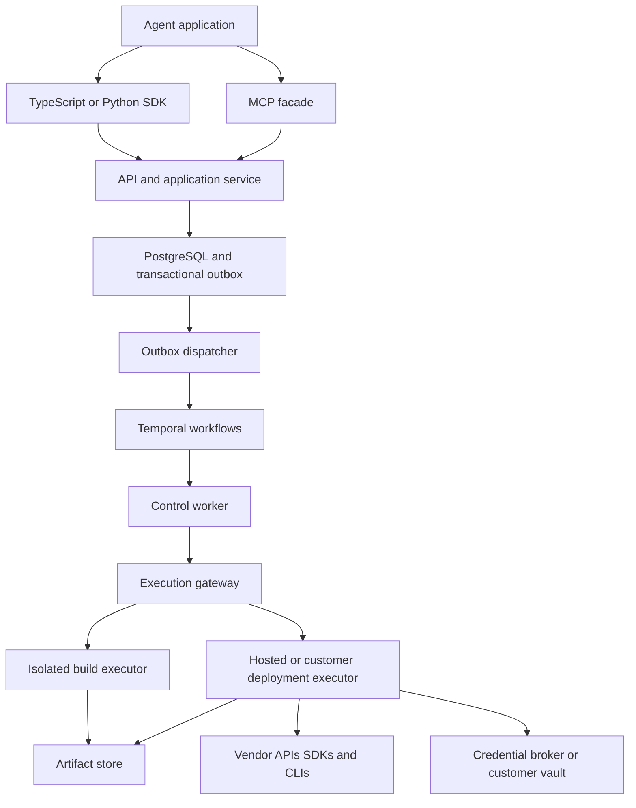

# Native Application SDK Technical Architecture

Build a shared application delivery system whose adapters create platform-specific native applications on Databricks, Palantir Foundry, Snowflake, and Microsoft Fabric. Share identity, operations, artifact handling, policy, and deployment records. Each adapter owns its application schemas, templates, toolchains, and native resource semantics.

Status: proposed implementation baseline, November 9, 2026. This is a design, not a claim that integrations have been tested against customer tenants.

## Scope and implementation choices

The agent builds a different application for each platform. Cross-platform application portability is out of scope. Palantir means Foundry/AIP, not Gotham or deployment of the Foundry platform itself.

The initial product is a multi-tenant HTTP service with TypeScript and Python clients, an MCP facade, and durable workers. A Python adapter runtime avoids duplicating vendor integration logic across languages. TypeScript is the primary client for an existing or future agent application; it is not the deployment runtime. The existing workspace has no application implementation to preserve.

Version one supports one bounded application type per platform:

| Platform | Application kind | Initial scope |
| --- | --- | --- |
| Databricks | `databricks.app/v1` | A Python web app deployed as a Databricks App; references an existing SQL warehouse and existing governed data. |
| Palantir | `palantir.superrepo/v1` | A React/OSDK frontend using an existing Ontology, packaged through SuperRepo where enabled; read-only Ontology access first. |
| Snowflake | `snowflake.native-app/v1` | A SQL and Streamlit Native App package and an installed development instance; named version and controlled upgrade path. |
| Fabric | `fabric.solution/v1` | A lakehouse and notebook item set with explicit dependencies and environment bindings. This is a workspace solution, not an arbitrary hosted web app. |

Fabric custom workloads are a separate later kind, `fabric.workload/v1`, requiring hosting and workload registration. Snowpark containers, arbitrary Ontology edits, public marketplaces, platform/account provisioning, autonomous destructive migrations, and general-purpose remote shell access are outside the initial scope. Supported applications can be extended after the first complete delivery path works.

All four targets require actual development environments and identities before integration acceptance. A platform is `experimental` until its create, update, health, and failure-recovery suite passes in the relevant environment.

## Recommended stack

| Concern | Choice | Reason |
| --- | --- | --- |
| API and domain service | Python 3.12, FastAPI, Pydantic 2 | One integration language; validated contracts and OpenAPI generation. |
| Adapter runtime | Python protocols and Pydantic models; pinned vendor SDKs and CLIs | Native toolchains remain available without rewriting them. |
| Durable orchestration | Temporal Python SDK | Long operations, activity checkpoints, retries, signals, and recoverable worker execution. |
| Durable data | Managed PostgreSQL 17, SQLAlchemy 2, Alembic | Tenant-scoped records, constraints, transactional outbox, deployment locks. |
| Artifacts | Azure Blob Storage through an `ArtifactStore` interface | Immutable archives, logs, and manifests; local filesystem implementation for development. |
| Credentials | Azure Key Vault through `CredentialBroker` | Server-side resolution; customer worker can use its own vault. |
| Client SDK | Generated TypeScript types and HTTP transport, handwritten ergonomic facade | Stable public interface without duplicating adapter behavior. |
| Node tooling | Node.js 24 LTS, pnpm, TypeScript | Client, CLI, and generated React builds; lock versions before implementation. |
| MCP facade | Official Python MCP SDK, Streamable HTTP; stdio bridge for local clients | Reuses the API service layer and authorization. |
| Tests | pytest, HTTPX/RESPX, Temporal test environment, Vitest | Contract, recovery, HTTP client, and integration coverage. |
| Telemetry | OpenTelemetry, structured JSON logs | Correlate agent request, operation, worker activity, and vendor request. |
| Development | uv workspace, pnpm workspace, Docker Compose | Reproducible local setup without Kubernetes. |
| Initial hosting | Azure Container Apps for API and long-lived control workers; isolated build/deploy jobs | Azure is a proposed hosting default, not a target-platform restriction. |
| CI | GitHub Actions, OCI worker images pinned by digest | Repeatable packaging, adapter compatibility tests, and release manifests. |

Use Temporal Cloud if allowed by customer residency requirements; self-host Temporal for restricted environments. Keep large artifacts, sensitive vendor responses, and credential values out of workflow history. Artifact references, operation IDs, and sanitized checkpoints may enter history. Customer deployment workers do not receive direct Temporal or PostgreSQL access.

Select exact dependency patches and image digests in the first implementation task and commit lockfiles. Runtime versions above are the proposed compatibility baseline, not a requirement for generated applications. Individual adapter images can have different runtimes where vendor toolchains require them.

FastAPI provides OpenAPI support; Pydantic exports JSON Schema; Temporal supplies a Python orchestration SDK. These capabilities support this stack choice, while its composition is our design. [FastAPI](https://fastapi.tiangolo.com/features/), [Pydantic JSON Schema](https://docs.pydantic.dev/latest/concepts/json_schema/), [Temporal Python SDK](https://docs.temporal.io/develop/python), [official MCP SDKs](https://modelcontextprotocol.io/docs/sdk).

## Service and execution boundaries



Start with a modular monolith API and one control-worker service. Run each build or deployment in a fresh isolated executor using an adapter image. Split services only for a demonstrated operational boundary. The gateway is a module of the API initially, not an independent microservice.

Temporal workflows contain deterministic coordination only. Network calls, database changes, and job dispatch happen in activities. Activities dispatch immutable `ExecutionJob` records and wait/poll for gateway results; they do not execute untrusted application code in the control-worker process.

Hosted execution provisions isolated container jobs. Private execution uses a customer-managed supervisor that polls the gateway over outbound HTTPS with a worker identity scoped to one tenant and worker pool. It launches a fresh local container for each job. There is no inbound connection into the customer network and no shared vendor credential store between customers.

Build jobs install dependencies and execute generated code without deployment credentials. If SDK generation requires platform access, use a separate narrowly scoped metadata/materialization step and record its outputs; never give the general build process the deployment principal. Deployment jobs use trusted adapter code, receive scoped credentials, and consume an immutable artifact. App installation SQL and native build steps can still have vendor-side effects: list these in the plan and restrict the deployment principal accordingly.

Credentialed deployment permits only reviewed vendor command paths and adapter-generated deployment configuration. Reject repository-controlled local build hooks, shell commands, plugins and install scripts in that path; run those in credential-free preparation and deploy prepared output where the vendor supports it. Validate the final deployment configuration after rendering and before execution. If a native tool cannot separate local arbitrary code execution from credentials, that route is unavailable for untrusted projects until a tested alternative exists; stronger container isolation does not make credentials invisible to code inside the container. Vendor-side app startup and Snowflake setup SQL are intentional native execution, separately bounded by runtime/install privileges and planned effects. Task 2 must prove this distinction for each chosen CLI route, particularly SuperRepo.

Hostile customer code requires a VM/microVM boundary or a dedicated customer compute boundary. A fresh Docker container alone is not the tenant isolation claim. The initial controlled pilot can run trusted internal projects; admitting arbitrary customer-generated builds requires the hardened execution milestone.

## Repository structure

```text
apps/
  api/src/shifde_api/
    main.py
    auth.py
    routes/{connections,projects,builds,plans,deployments,operations,execution_jobs}.py
  control_worker/src/shifde_control_worker/{main,workflows,activities,dispatcher}.py
  mcp/src/shifde_mcp/{server,tools,auth}.py
  cli/src/{index,commands}.ts
packages/
  contracts/src/shifde_contracts/
    common.py
    projects.py
    builds.py
    capabilities.py
    plans.py
    operations.py
    execution.py
    platform_specs/{databricks,palantir,snowflake,fabric}.py
  core/src/shifde_core/
    service.py
    adapter.py
    registry.py
    policy.py
    credentials.py
    artifact_store.py
    execution.py
    persistence/{models,repositories,outbox,locks}.py
  adapters/
    databricks/src/shifde_databricks/
    palantir/src/shifde_palantir/
    snowflake/src/shifde_snowflake/
    fabric/src/shifde_fabric/
  sdk_python/src/shifde_sdk/{client,operations}.py
  sdk_typescript/src/{generated,client,operations,index}.ts
  adapter_testkit/src/shifde_adapter_testkit/{conformance,fakes}.py
executors/src/shifde_executor/{supervisor,sandbox,credentials,runner}.py
templates/{databricks-app,palantir-superrepo,snowflake-native-app,fabric-solution}/
agent_packs/{databricks,palantir,snowflake,fabric}/
schemas/{openapi.json,application-specs/}
tests/{contracts,api,workflows,execution,adapters,live}/
infra/{compose.yaml,containers/,azure/}
  tools/{export_contracts.py,generate_clients.py}
docs/superpowers/{specs,plans}/
pyproject.toml
uv.lock
package.json
pnpm-workspace.yaml
pnpm-lock.yaml
```

`shifde` is a proposed package prefix based on this workspace name; public npm/PyPI name availability is not established. These paths describe planned source, not already-created software.

Each adapter package uses `adapter.py`, `schemas.py`, `capabilities.py`, `inspect.py`, `validate.py`, `build.py`, `plan.py`, `apply.py`, `observe.py`, `verify.py`, `clients.py`, and `manifest.json`. Keep optional native operations in `extensions/`; register them by reviewed static configuration, not arbitrary remote plugins. `agent_packs` contains versioned platform instructions, examples, and links, never credentials or executable deployment authority.

## Contract ownership and versioning

Pydantic models are the canonical wire contracts. Export OpenAPI from FastAPI and JSON Schema for application kinds. Generate TypeScript types and transport from these exports; Python SDK consumes the same models. CI fails when regeneration changes tracked output. Examples and generated clients must compile in CI.

Version the API (`/v1`), application kinds (`databricks.app/v1`), SDK packages, adapter packages, templates, and worker images independently. Pin their tested combinations in a release manifest. Never silently upgrade a CLI inside a running worker image. Resume an operation with the recorded adapter/image; replacing either requires a new plan or a documented migration.

Use a discriminated union of native application specifications. There is no generic cross-platform resources language. `Application` is the stable managed identity: `id`, `tenant_id`, `application_kind`, `name`, and `owner`. A shared `Project` is an immutable application revision with `id`, `application_id`, `tenant_id`, `application_kind`, `spec`, `source_ref`, and `revision`; `spec` is strictly validated against its kind. Native project files remain the source of application detail, and generated source can be edited by the agent in Git. New source creates a new project revision under the same application ID; it does not create another managed application. A deployment record is one attempt to deliver that application to a target.

| Application specification | Required native fields |
| --- | --- |
| Databricks | `bundle_target`, `bundle_root`, `app_resource_key`, `warehouse_binding`, `health_path` |
| Palantir | `superrepo_root`, `ontology_binding`, `osdk_package`, `frontend_path`, `product_binding` |
| Snowflake | `project_root`, `package_binding`, `application_binding`, `warehouse_binding`, `release_version`, `release_patch` |
| Fabric | `solution_root`, `items[]` with stable local key, item type, definition path and `depends_on`; `bindings` |

All roots and paths are relative to the source archive; reject absolute paths, traversal, escaping symlinks, and duplicate archive entries. Bindings resolve to server-controlled environment values and vendor IDs. Do not allow source configuration to override the authenticated tenant, connection host, deployment identity, or worker pool. Never interpolate arbitrary source text into a shell command.

## Shared interfaces

The following signatures define the adapter seam. Their referenced DTOs are specified in the next table and implemented as Pydantic models; they are not vendor API signatures.

```python
from typing import Protocol

class PlatformAdapter(Protocol):
    async def capabilities(self, ctx: "ReadContext") -> "CapabilityReport": ...
    async def inspect(self, request: "InspectRequest", ctx: "ReadContext") -> "EnvironmentSnapshot": ...
    async def scaffold(self, request: "ScaffoldRequest", ctx: "BuildContext") -> "SourceArchive": ...
    async def validate(self, request: "ValidateRequest", ctx: "BuildContext") -> "ValidationReport": ...
    async def build(self, request: "BuildRequest", ctx: "BuildContext") -> "BuildArtifact": ...
    async def plan(self, request: "PlanRequest", ctx: "ReadContext") -> "DeploymentPlan": ...
    async def apply(self, request: "ApplyRequest", ctx: "DeployContext") -> "ApplyReceipt": ...
    async def observe(self, request: "ObserveRequest", ctx: "ReadContext") -> "NativeObservation": ...
    async def reconcile(self, request: "ReconcileRequest", ctx: "ReadContext") -> "ReconciliationResult": ...
    async def verify(self, request: "VerifyRequest", ctx: "ReadContext") -> "VerificationReport": ...
```

| DTO | Required content |
| --- | --- |
| `ReadContext` | Authenticated tenant, connection/target, operation ID, scoped credential resolver, vendor clients, deadline, redacted logger. |
| `BuildContext` | Tenant and operation ID, artifact store, isolated workspace, pinned toolchain; no deployment credential resolver. |
| `DeployContext` | `ReadContext` plus step journal, artifact reader, policy decision ID, lock/fencing token. |
| `InspectRequest` | Application kind and bounded resource selectors; target comes from context. |
| `ScaffoldRequest` | Kind, template version, validated native spec. |
| `ValidateRequest` | Kind, immutable source reference, native spec. |
| `BuildRequest` | Immutable source reference, spec digest, validated template/toolchain versions, materialized dependencies. |
| `PlanRequest` | Build artifact ID/digest, target ID, deployment ID if updating, environment bindings. |
| `ApplyRequest` | Stored plan ID/digest, immutable artifact reference, deployment ID, deterministic step keys. |
| `ObserveRequest` | Apply receipt and last native-operation checkpoints. |
| `ReconcileRequest` | Deployment ID, step journal, last receipt if present, desired artifact digest. |
| `VerifyRequest` | Deployment ID, native resource map, kind-specific verification profile. |
| `SourceArchive` | Tenant-scoped object ID, SHA-256 digest, source commit if present, archive format. |
| `ValidationReport` | `passed`, diagnostics with file/field paths, static checks and materialization prerequisites. |
| `EnvironmentSnapshot` | Native IDs, revisions/ETags where supplied, required dependencies, access observations, capture timestamp, fingerprint. |
| `CapabilityReport` | Adapter/image versions, kinds, operations, status `supported/unsupported/unknown`, reason, identity constraints, required features, evidence and probe expiry. |
| `BuildArtifact` | Archive ID/digest, kind, source/spec digests, toolchain image digest, adapter/template versions, dependency locks, validation report ID. |
| `DeploymentPlan` | Artifact and target binding, snapshot/preconditions, ordered dependency steps, adds/updates/deletes/unknown effects, grants, reversibility, expiry, digest. |
| `ApplyReceipt` | Native IDs and operation handles, step results, submitted artifact digest; receipt does not mean healthy. |
| `NativeObservation` | Native state, resource map, updated checkpoints, terminal indicator, redacted diagnostics. |
| `ReconciliationResult` | `applied/not_applied/in_progress/ambiguous`, evidence, current resource map; ambiguous forbids automatic resubmission. |
| `VerificationReport` | Passed/failed/skipped checks, evidence, health endpoint or native status; required skipped checks prevent success. |

All persisted DTOs use UUID `id` fields; object digests use SHA-256, timestamps use UTC RFC 3339, and `application_id` links projects/artifacts/plans/deployments to stable ownership. An operation result is a discriminated union keyed by `result_kind`; bounded metadata is returned inline while bytes and large diagnostics are artifact references.

`scaffold`, `validate`, `build`, `plan`, `apply`, and `verify` may take time. The public API schedules them as operations; this internal adapter protocol is not an HTTP request lifetime. A narrow metadata-generation job can precede build if capabilities require it; it outputs a pinned materialization archive and uses a distinct read-only credential scope. `verify` performs read-only observation of results. Any verification that executes code or changes state, including a Fabric notebook run, is an explicit final apply step with its own policy scope, step intent, native operation receipt and reconciliation rule; `verify` then reads its recorded outcome.

Optional extensions implement `invoke_extension(name: str, payload: dict, ctx: ReadContext | DeployContext) -> ExtensionResult`. An extension registry declares its input/output JSON Schemas, required privilege, side effects and idempotency semantics. Mutations route through plans and workers. Do not expose `run_sql`, `run_shell`, or arbitrary HTTP requests as a shortcut around this policy.

## Build and deployment lifecycle

1. Register a connection and target. Probe platform features and identity constraints. Unsupported or unknown required capabilities stop deployment.
2. Agent obtains a template and native schema, writes platform-specific source in Git or an authorized coding sandbox, and submits an archive or pinned commit. LLM generation stays outside the core SDK.
3. Validate and build in isolation. Store an immutable deployment input archive, dependency locks and provenance. A deployment input may contain source if the vendor performs its own final build; it is not a claim of a reproducible vendor binary.
4. Plan against that exact artifact and the target snapshot. The plan has a 15-minute start TTL and explicitly reports unknown remote effects. A native server validation that writes state belongs in deployment, not the read-only plan phase.
5. Evaluate policy. Default development policy allows bounded creates and updates to owned resources; deny unplanned deletion, privilege escalation and destructive replacement. Production may require recorded approval according to configured tenant policy. No unconditional interactive approval is built into the SDK.
6. Request deployment using the stored plan and artifact IDs. Acquire an application/target lock, reread ownership/preconditions, check plan TTL and policy, and dispatch execution.
7. Adapter applies the ordered steps. Journal intent before each write; record vendor operation handles immediately after receipt. Observe long-running native operations and then verify required health checks.
8. Publish a deployment record with native IDs, actual artifact digest, check results, and version. Promotion builds a new target-specific plan from the same artifact; it never rebuilds silently.

The binding hash is SHA-256 over canonical JSON containing the immutable artifact digest, spec digest, target ID and connection revision, environment bindings, adapter and image versions, observed preconditions, and exact planned step definitions. Arrays remain ordered. Changes invalidate the plan. Use one canonical encoder on the server; clients never compute authoritative hashes.

An operation is `queued`, `running`, `waiting_for_policy`, `reconciling`, `needs_attention`, `succeeded`, `failed`, or `cancelled`. Legal paths include queued to running; running to waiting_for_policy/reconciling/succeeded/failed/needs_attention; waiting_for_policy to running/failed/cancelled; reconciling to running/needs_attention/failed. Terminal states do not resume. `needs_attention` can resume into reconciling through an authorized resume request. Cancellation during execution is cooperative: stop scheduling further writes, inspect in-flight native actions, and report residual effects before terminal cancellation.

Temporal retries are at least once; native writes are not assumed exactly once. Persist API idempotency keys scoped to tenant, route and canonical body hash for seven days. The same key/body returns the same operation; a different body returns 409. Journal intent before side effects and reconcile after uncertainty, including a crash between native acceptance and checkpoint persistence. If absence cannot be proved, enter `needs_attention`. Never guess based only on display name. Honor Retry-After for 429 and apply capped jittered backoff for safe reads. Do not blindly replay mutations on 5xx or timeouts.

Create the operation and outbox entry in one PostgreSQL transaction; dispatch a Temporal workflow with deterministic ID equal to the operation ID. Duplicate dispatch is harmless. Locks are tenant/application/target scoped and renewable with monotonic fencing tokens. Check ownership between steps; a stale executor cannot report success. Because vendors may not honor fencing tokens, do not start a replacement executor until the original job is terminated or its outcome is reconciled.

Also lock every managed native resource a plan will change, in sorted canonical resource-key order, to prevent overlapping application plans from mutating the same resource. Keys include platform and normalized account/workspace scope plus native ID or reserved qualified identifier, not connection aliases. Enforce exclusive management ownership; references to shared resources are read-only unless explicitly adopted. Version one gives each application/target its own Snowflake package and instance, prohibiting shared mutable packages across targets. Cross-account consumer distribution and shared package promotion require a later explicit ownership model. Registration must prevent overlapping managed namespaces across tenants; native external writers remain an observed concurrency limit.

Plans are honest about their precision: use native dry-run/plan support when tested; otherwise show observed resource diffs and mark unknown effects. Deny high-risk unknown effects under the default policy. No global automatic rollback: code reversion, schema recovery, and external side-effect repair are distinct native operations.

## Platform adapter implementations

### Databricks

Use Databricks SDK for workspace inspection, app/resource status and permissions, and the Databricks CLI for bundle-managed application delivery. Generate `databricks.yml`, `app.yaml`, Python source, dependency locks and a health route. Keep bundle root paths stable per application/environment rather than per ephemeral worker identity. Preserve native bundle state; do not separately mutate resources the bundle owns.

Validate configuration locally; deploy the bundle and then start/restart the app using its bundle resource key. Poll app and deployment status, then run an authenticated health check and a bounded read against the configured warehouse. Application deployment identity and the app's runtime data identity are separate; validate both.

Bundle deployment tracks native resource IDs and can remove resources absent from configuration. Include those deletions in the plan. The CLI documents a separate app start step and warns that command completion is not application health. [Bundle commands](https://docs.databricks.com/aws/en/dev-tools/cli/bundle-commands), [Apps deployment](https://docs.databricks.com/aws/en/dev-tools/databricks-apps/deploy).

### Palantir Foundry

Use Platform/OSDK clients for supported resource inspection and app data access. Use an enrollment-compatible Foundry CLI and SuperRepo for the full source-build-product delivery path when available. Generate a React frontend, OSDK bindings against existing Ontology resources, and product/environment configuration. Treat ontology mutation and new function resources as later separately tested capabilities.

The feasibility gate must test enrollment feature availability, noninteractive authentication, CLI installation/version management, external build, deployment status observation, and in-place update semantics. Obtain the CLI through the enrollment's documented installation process in an authorized provisioning environment; pin and retain its provenance. Do not redistribute enrollment-specific binaries without confirming terms. If unavailable, report this application kind unsupported; a frontend-only Developer Console workflow is a separate future kind, not a silent fallback.

SuperRepo supports external build/deploy and Marketplace products, but the Foundry CLI documentation currently labels SuperRepo beta and enrollment-dependent. [SuperRepo concepts](https://www.palantir.com/docs/foundry/superrepo/core-concepts), [Foundry CLI and authentication](https://www.palantir.com/docs/foundry/superrepo/foundry-cli), [Developer Console](https://www.palantir.com/docs/foundry/developer-console).

### Snowflake

Use Snowflake Connector/SQL APIs for metadata, explicit package/application DDL and status. Use Snowflake CLI for native packaging/stage synchronization. Generate `snowflake.yml`, `manifest.yml`, setup SQL, Streamlit source and dependency definitions. Keep logical SDK bindings distinct from quoted native SQL identifiers; allow only validated identifiers and structured parameter handling.

Separate package synchronization, native setup validation, named-version creation and instance installation/upgrade into journaled steps. Perform server-side validation in an owned development package because it can write remote state. Default first acceptance covers one provider/development account; installation into other consumer accounts is later distribution scope. Use explicit create/alter application operations for controlled instance transitions; inspect version compatibility and never permit an implicit drop-and-recreate path.

`snow app deploy` synchronizes a package without installing/upgrading an application. `snow app run` installs/upgrades, but can prompt for destructive replacement if an upgrade cannot be completed; an unattended adapter must not globally force that path. [Package command](https://docs.snowflake.com/en/developer-guide/snowflake-cli/command-reference/native-apps-commands/deploy-app), [Run command behavior](https://docs.snowflake.com/en/developer-guide/snowflake-cli/command-reference/native-apps-commands/run-app).

### Microsoft Fabric

Use Azure Identity for supported Entra identities and HTTPX for Fabric REST APIs. Generate item definitions plus a dependency manifest. Create/resolve the lakehouse, persist local-key-to-native-ID mappings, bind the notebook to the target lakehouse, then create/update its definition. Preserve documented logical IDs when definitions require them. Only supported definition fields and APIs enter the initial resource catalog.

Handle 201 and 202 separately; persist operation ID and Location, respect Retry-After, and poll the native operation to completion. Verify metadata and an explicitly authorized bounded notebook execution. Probe capacity, tenant service-principal settings and support for each item API. Item credentials/connections requiring human configuration must appear as prerequisites rather than a false successful deployment.

A custom Fabric UI is `fabric.workload/v1` later: it needs hosted frontend/backend, manifests, registration and tenant enablement plus its own hosting adapter. Fabric's extensibility architecture loads a developer-hosted application in an iframe. Do not claim that the workspace solution kind provides that UI. [Create Item and identity limits](https://learn.microsoft.com/en-us/rest/api/fabric/core/items/create-item), [Extensibility architecture](https://learn.microsoft.com/en-us/fabric/extensibility-toolkit/architecture).

## API and SDK surface

| Endpoint | Behavior |
| --- | --- |
| `POST /v1/connections` | Registers allowlisted host/account coordinates and credential reference; never returns secret values. |
| `POST /v1/targets` | Creates connection/environment/worker-pool bindings. |
| `GET /v1/targets/{id}/capabilities` | Returns timestamped capability report; refresh can schedule an inspection operation. |
| `POST /v1/inspections` | Queues bounded target inspection. |
| `POST /v1/scaffolds` | Queues template rendering; returns source archive through operation result. |
| `POST /v1/applications` | Registers a stable application identity and native kind. |
| `POST /v1/source-uploads` | Issues a short-lived tenant-scoped upload grant; finalize verifies the archive digest. |
| `POST /v1/source-upload-completions` | Verifies uploaded bytes and returns an immutable SourceArchive reference. |
| `POST /v1/projects` | Registers an immutable revision with application ID, validated native spec and source reference. |
| `POST /v1/validations` | Queues source/static validation. |
| `POST /v1/builds` | Queues immutable artifact production. |
| `POST /v1/plans` | Queues plan creation against a target and artifact. |
| `POST /v1/policy-decisions` | Records an authorized policy decision/approval when tenant policy requires it. |
| `POST /v1/deployments` | Queues application deployment from stored plan and artifact IDs. |
| `GET /v1/deployments/{id}` | Returns current/partial resource state and health. |
| `GET /v1/operations/{id}` | Returns durable state, typed result reference or sanitized error. |
| `GET /v1/operations/{id}/events` | Cursor-based ordered event polling. |
| `POST /v1/operation-cancellations` | Requests cooperative cancellation. |
| `POST /v1/operation-resumptions` | Requests reconciliation/resumption of a needs_attention operation. |

Long operations return HTTP 202 with an operation representation and Location header. Immediate registration returns 201. Errors use `{error: {code, message, details, trace_id}}`. Use 409 for stale plans, lock/idempotency conflicts and source revision conflicts; 422 for invalid native specs. Cursor pagination is stable on event sequence. Connection and target updates use PATCH with If-Match; changes invalidate prior plans. Project revisions are immutable. Route authorization derives tenant from verified identity, never from a client-supplied tenant ID alone.

Upload archives directly using scoped upload grants; only server-verified digests become source references. Git materialization accepts registered repository connections and commit SHAs, not arbitrary clone URLs. Validation-only local SDK helpers are allowed, but a local helper cannot bypass service deployment policy.

Illustrative TypeScript client usage, with methods generated/implemented by the plan:

```ts
const sdk = new ShifdeClient({ baseUrl, tokenProvider });
const buildOp = await sdk.builds.create({ projectId }, { idempotencyKey: buildKey });
const artifact = await sdk.operations.waitForResult<BuildArtifact>(buildOp.id);
const planOp = await sdk.plans.create({ artifactId: artifact.id, targetId });
const plan = await sdk.operations.waitForResult<DeploymentPlan>(planOp.id);
const deployOp = await sdk.deployments.create(
  { planId: plan.id, artifactId: artifact.id },
  { idempotencyKey: deployKey },
);
const deployment = await sdk.operations.waitForResult<Deployment>(deployOp.id);
```

`waitForResult` validates result kind at runtime, supports AbortSignal/client deadline, and throws typed failed/cancelled/needs_attention errors. Waiting_for_policy is surfaced with required action and can be waited on only by explicit caller choice. Aborting client polling does not cancel a remote operation. The generic type is convenience, not runtime trust.

## Agent and MCP integration

Use fixed MCP tools `platform_capabilities`, `inspect_environment`, `scaffold_project`, `validate_project`, `build_application`, `plan_deployment`, `deploy_application`, `get_operation`, and `get_operation_events`. A `platform_schema` tool returns the selected native schema and agent pack version. Both MCP and HTTP call `ApplicationService`; no adapter runs inside MCP handlers. MCP authentication forwards the verified principal/authorization context, never a privileged service token that erases the caller.

Return operation IDs for lengthy tools. Require stored plan IDs for mutations. Platform-specific extension tools are optional and explicitly registered with schemas, authorization and lifecycle routing. Vendor MCP servers may provide additional platform context, but are not the sole deployment dependency. Do not add an LLM framework or model provider to the SDK core; the caller supplies its agent runtime.

## Persistence and operational controls

Core tables: `tenants`, `principals`, `memberships`, `connections`, `targets`, `applications`, `projects`, `source_archives`, `artifacts`, `plans`, `policy_decisions`, `deployments`, `resource_bindings`, `operations`, `operation_events`, `step_journal`, `idempotency_keys`, `outbox`, `execution_jobs`, `worker_pools`, and `deployment_locks`.

Every tenant-owned row carries `tenant_id`; repositories require tenant context and compound tenant/ID foreign keys. Use database row-level isolation as defense in depth with transaction-local tenant identity; background jobs explicitly set it. Enforce append-only event/audit writes through database roles. A database implementation task must include the project's Postgres guidance before writing migrations.

Persist resource ownership as tenant/application/target plus native ID. Name matches alone do not establish ownership. Existing resources can be referenced; adoption into management requires an explicit checked binding. Drift outside the application is not automatically overwritten. Re-inspect before apply; without vendor revision/CAS support, report the remaining external-writer race and use conservative changes plus post-apply verification.

Execution gateway endpoints: `POST /internal/v1/job-leases`, `POST /internal/v1/execution-jobs/{id}/heartbeats`, `POST /internal/v1/execution-jobs/{id}/checkpoints`, `POST /internal/v1/execution-jobs/{id}/credential-grants`, and `POST /internal/v1/execution-jobs/{id}/results`. Jobs carry lease ID, fencing token, audience, expiry, artifact digest, step, target and image digest; authentication scopes workers to a tenant/pool and permitted image set. Poll responses never include credential values. Resolve credentials at execution through a job-bound grant; customer workers resolve a local vault reference. A mismatched or stale lease cannot upload an accepted result.

The checkpoint endpoint synchronously commits monotonic per-step intent/receipt records to PostgreSQL before acknowledging them. Executors must receive intent acknowledgement before a native write, then persist its receipt before executing the next step. A disconnected executor stops new writes and retains any pending receipt for resubmission; it does not assume a missing acknowledgement means the native action failed. The gateway checks planned step membership, operation ownership, lease and fencing token on every append. Duplicate identical checkpoint keys return the saved record; conflicting payloads return 409. This closes the missing private-worker journal path while retaining the unavoidable native-acceptance crash window handled by reconciliation.

Refresh supported OAuth tokens before expiry; handle vendor-specific nonrefreshable tokens through an explicit credential-expired state. Default identity preference is supported workload federation, then service identity, then scoped user OAuth when required. Runtime app end-user identity is a separate adapter concern from deployer identity. Never assume one OAuth scope model fits all vendors.

Set connect timeout 5 seconds and ordinary read timeout 30 seconds; asynchronous operations use workflow deadlines rather than an unbounded HTTP call. Initial workflow deadline is 60 minutes, configurable per application kind. Logs are sanitized before storage and before returning to agents. Retain operational metadata for 90 days and artifacts for 30 days by default; pin active deployments and referenced rollback versions against garbage collection. Retention is configurable per tenant.

## Release acceptance and later work

A supported kind passes the same behavioral suite: create and verify; edit and update the same owned resources; deploy to a second target with new bindings; reject stale plans; prevent cross-tenant access; survive worker death and uncertain native acceptance without duplicate creation; surface invalid permissions/capacity; and identify partial state after failure. A passing fake is necessary but does not establish vendor support.

Start by proving external authentication and deployment for all four in disposable development environments, then complete Databricks end to end, Snowflake, Fabric, and the feature-gated Palantir path. Palantir availability is checked early so a beta feature cannot become a late project surprise. Do not advertise unavailable kinds as supported.

After the initial catalog: Fabric custom workloads, additional Databricks resources, Palantir Ontology/functions authoring, Snowpark Container Services, consumer distribution, explicit migration/recovery profiles, and additional language clients. Each adds an application kind or a tested extension without changing the shared lifecycle.

Planning assumption: two experienced engineers plus access to platform administrators; approximately 12–18 engineering weeks for the bounded four-platform pilot, not a fixed estimate for a general application factory. Re-estimate after authentication and deployment spikes. Vendor enrollment, licensing, security review and production distribution can add elapsed time independently of coding.
